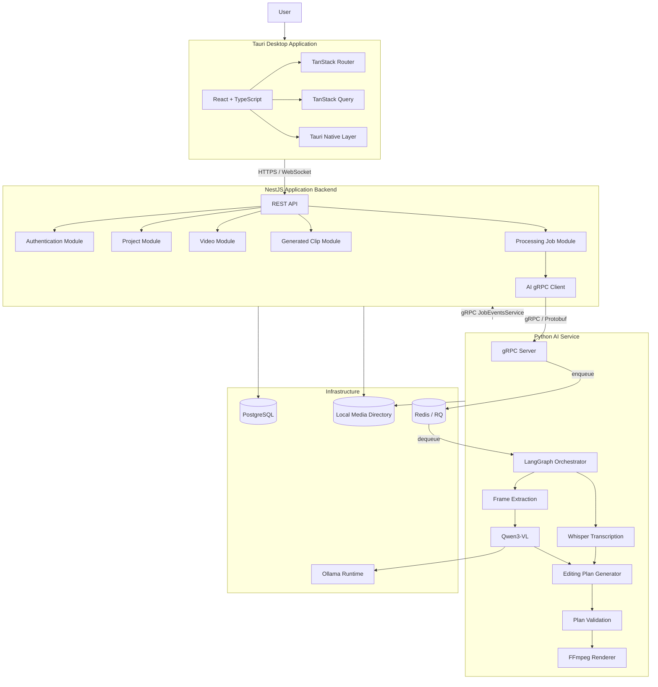
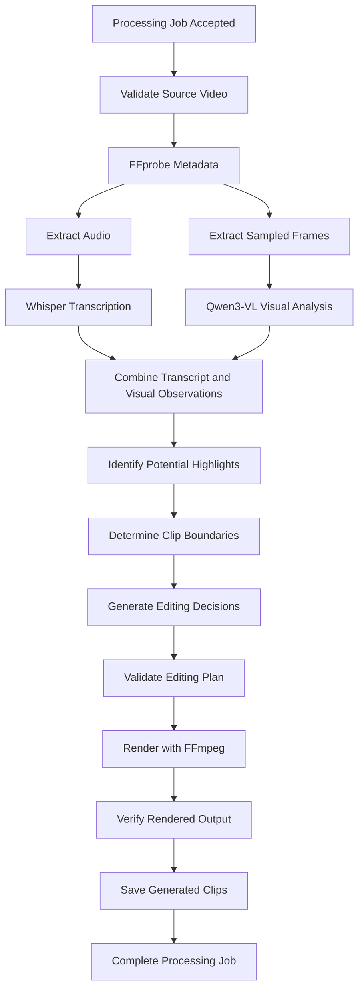

# ClipForge AI — System Architecture

**Document type:** Technical Architecture  
**Project:** ClipForge AI  
**Version:** 1.0  
**Scope:** MVP and future architecture  
**Primary objective:** Automatically transform uploaded source videos into polished, short-form videos using local AI models.

---

# 1. Product Overview

ClipForge AI is an AI-powered desktop application that automatically converts long-form videos or raw footage into short-form content suitable for platforms such as:

- TikTok
- YouTube Shorts
- Instagram Reels
- Facebook Reels

The user uploads one or more source videos. The system analyzes their audio and visual content, identifies engaging moments, generates editing decisions, and renders finished short-form videos.

The primary value of the application is automated video editing. Users should not need to manually search through long videos, select timestamps, trim footage, or create subtitles.

## 1.1 Core User Story

As a content creator, I want to upload my source videos and have AI automatically identify interesting moments, edit them into short-form videos, and prepare them for publishing.

## 1.2 MVP User Experience

1. User opens ClipForge AI.
2. User creates a project.
3. User uploads one or more source videos.
4. User starts AI processing.
5. The application analyzes each source video independently.
6. The AI identifies engaging moments.
7. The system generates editing instructions.
8. FFmpeg renders the selected moments.
9. User sees the generated short-form videos.
10. User previews and downloads the results.

Each source video is processed independently in the MVP. Combining footage from multiple source videos into one short-form video is a future capability.

---

# 2. MVP Scope

The MVP should prove that ClipForge AI can reliably complete the entire workflow.

## 2.1 Features included in MVP

### Project management
- Create projects.
- View projects.
- Rename projects.
- Delete projects.

### Video management
- Import source videos (native file picker; files are copied into the media directory).
- Support multiple imported videos per project.
- Display import progress.
- Display video metadata.
- Delete imported videos.

### AI video analysis
- Extract audio using FFmpeg.
- Extract representative video frames.
- Transcribe speech using Whisper.
- Analyze sampled frames using a vision-language model.
- Identify engaging moments.
- Generate structured editing decisions.
- Generate subtitles.
- Generate suggested titles and captions.

### Automated video rendering
- Trim selected video segments.
- Convert to vertical 9:16.
- Apply basic reframing.
- Generate and burn subtitles.
- Export MP4 videos.
- Generate video thumbnails.

### Generated video management
- Display generated clips.
- Preview generated clips.
- Download generated videos.
- Display processing status.
- Display processing errors.

### AI Model Experimentation
- Select an installed local vision model.
- Run video analysis against that model.
- Inspect AI-generated visual analysis.
- Compare model outputs.
- Record processing duration and model information.

The experiment feature will use the same analysis infrastructure as the main pipeline. It should not become a separate AI architecture.

## 2.2 Explicitly excluded from MVP

Do not implement these features yet:

- Direct social media publishing.
- Social media account integrations.
- Multi-video footage merging.
- Manual multitrack timeline editing.
- Advanced transitions and effects.
- Advanced color grading.
- AI-generated B-roll.
- AI-generated avatars.
- Background music generation.
- Advanced speaker tracking.
- Multiple AI agents with independent responsibilities.
- Distributed rendering across multiple machines.
- Cloud GPU inference.
- Subscription and payment systems.

These can be considered after the application is usable.

---

# 3. Technology Stack

| Layer | Technology |
|---|---|
| Desktop framework | Tauri 2 |
| Frontend | React + TypeScript |
| Routing | TanStack Router |
| Server state | TanStack Query |
| UI | Tailwind CSS + shadcn/ui |
| Backend | NestJS |
| Internal communication | gRPC + Protocol Buffers |
| AI service | Python + FastAPI |
| AI orchestration | LangGraph |
| Model integrations | LangChain |
| Vision model | Qwen3-VL 8B / 4B |
| Speech recognition | faster-whisper |
| Local model runtime | Ollama |
| Video processing | FFmpeg / FFprobe |
| Database | PostgreSQL 16 (local) |
| Media storage | Local filesystem (`MEDIA_ROOT`) |
| Job queue | Redis + RQ |
| ORM / migrations | Drizzle ORM + drizzle-kit (SQL migrations, applied at API startup) |
| Authentication | Single local user, no login (see §11) |
| Logging | Pino + structlog + Rust tracing |
| Observability | OpenTelemetry |
| Version control | Git + GitHub |

## 3.1 Technology decisions

### Tauri 2

Tauri provides a native desktop shell using Rust and a web frontend.

It is selected instead of Electron to keep the desktop application relatively lightweight.

The React frontend handles the user interface, while Tauri provides native desktop capabilities such as file selection and application packaging.

### NestJS

NestJS will be the primary application backend.

It handles:

- Authentication integration.
- Projects.
- Source video metadata.
- Upload coordination.
- Processing job management.
- Generated clip metadata.
- Application APIs.
- AI service coordination.

For MVP, use a modular monolith rather than splitting every business domain into separate deployable services.

### Python FastAPI

Python is responsible for AI processing and media analysis.

It is a separate service because its ecosystem provides direct access to:

- PyTorch and model runtimes.
- faster-whisper.
- LangGraph.
- Computer vision libraries.
- FFmpeg integrations.
- AI inference tools.

### gRPC

Use gRPC for internal synchronous service communication.

For example:

NestJS -> Python AI Service

gRPC is useful for strongly typed internal contracts and efficient service-to-service communication.

Do not send entire video files through gRPC. Pass storage references, IDs, and processing configuration.

Long-running processing must not keep a gRPC request open. The service should accept the job and return an acknowledgment while processing continues asynchronously.

### PostgreSQL (local)

A local PostgreSQL 16 server holds all application data. Like the AI models and media, the database runs on the user's machine: ClipForge needs no cloud account to work.

NestJS connects through `DATABASE_URL`. Locally it uses the Unix socket with peer authentication, so no database password is stored. Video files are never stored in the database.

### Local media storage

Source videos, generated clips, thumbnails, and subtitles live on local disk under one configured `MEDIA_ROOT` directory. NestJS and the Python service run on the same machine and access it directly.

This avoids uploading multi-gigabyte footage to the cloud only to download it again on the same laptop. Each service accesses media through its storage module, so a cloud object store can replace it later without touching domain code.

### Redis + RQ

The Python service uses RQ (Redis Queue) to execute accepted jobs durably. `StartAnalysis` enqueues an RQ job whose ID equals the processing job ID; a single RQ worker executes it.

Redis runs locally with append-only persistence so queued jobs survive restarts. Only the Python service uses Redis.

### Ollama

Ollama provides a local model runtime.

It allows the application to use local models without requiring a paid hosted inference API.

---

# 4. High-Level Architecture



The diagram represents logical responsibilities. faster-whisper runs in-process inside the Python service; only the vision model is served by Ollama. For the MVP, the NestJS backend is one deployable application and the Python AI service is another. FFmpeg processing runs inside the Python service's worker process. Python never connects to Postgres: it reports job events to NestJS, which persists them.

---

# 5. Component Responsibilities

## 5.0 Monorepo Layout

```text
clipflow/
├── apps/
│   ├── desktop/      # Tauri + React (npm workspace)
│   ├── api/          # NestJS (npm workspace)
│   └── ai-service/   # Python (uv project)
├── proto/ai/v1/      # gRPC contracts, the single source for both services
├── doc/
├── .env.example      # one root .env, read by every app
└── package.json      # npm workspaces; Node 22 (.nvmrc)
```

Each app validates its configuration at startup and refuses to start on missing or invalid values.

## 5.1 Desktop Application

Location:

`apps/desktop`

Responsibilities:

- Render the desktop UI.
- Handle user navigation.
- Display projects.
- Import videos (native file picker).
- Show processing progress.
- Display generated clips.
- Preview and download videos.
- Configure AI experiments.
- Display AI analysis results.

Suggested structure:

```text
apps/desktop/
├── src/
│   ├── app/
│   │   ├── routes/
│   │   ├── providers/
│   │   └── router.tsx
│   ├── components/
│   │   ├── ui/
│   │   ├── layout/
│   │   └── shared/
│   ├── features/
│   │   ├── auth/
│   │   ├── projects/
│   │   ├── videos/
│   │   ├── processing/
│   │   ├── clips/
│   │   └── experiments/
│   ├── lib/
│   ├── hooks/
│   └── types/
├── src-tauri/
│   ├── src/
│   └── tauri.conf.json
└── package.json
```

The frontend must not communicate directly with Ollama, the Python AI service, or its workers.

All processing operations go through the NestJS API.

## 5.2 NestJS Backend

Location:

`apps/api`

Responsibilities:

- Manage application business logic.
- Validate requests.
- Resolve the acting user for every request (single local user; see §11).
- Manage projects and video records.
- Import source videos into the media directory.
- Create processing jobs.
- Request AI processing through gRPC.
- Host `JobEventsService` and persist job events reported by the Python service.
- Track processing status.
- Manage generated clip metadata.
- Expose REST endpoints.
- Provide progress updates to the desktop application.

Suggested structure:

```text
apps/api/
├── src/
│   ├── main.ts
│   ├── app.module.ts
│   ├── common/
│   │   ├── guards/
│   │   ├── interceptors/
│   │   ├── filters/
│   │   └── decorators/
│   ├── modules/
│   │   ├── auth/
│   │   ├── users/
│   │   ├── projects/
│   │   ├── videos/
│   │   ├── uploads/
│   │   ├── processing/
│   │   ├── clips/
│   │   ├── experiments/
│   │   └── health/
│   ├── infrastructure/
│   │   ├── database/
│   │   ├── grpc/
│   │   └── storage/
│   └── config/
└── package.json
```

NestJS loads the shared `proto/` files at runtime with `@grpc/proto-loader`; no generated code is committed.

Keep domain logic inside its corresponding module.

Do not make the NestJS application responsible for running FFmpeg or loading AI models.

## 5.3 Python AI Service

Location:

`apps/ai-service`

Responsibilities:

- Receive processing requests.
- Manage AI workflows.
- Extract audio and frames.
- Run speech transcription.
- Run visual analysis.
- Generate editing decisions.
- Validate AI outputs.
- Render generated videos.
- Report processing progress.
- Handle processing failures.

Suggested structure:

```text
apps/ai-service/
├── app/
│   ├── main.py
│   ├── grpc_server.py
│   ├── config.py
│   ├── api/
│   │   └── routes/
│   ├── workflows/
│   │   ├── video_analysis.py
│   │   └── states.py
│   ├── services/
│   │   ├── video/
│   │   │   ├── ffmpeg.py
│   │   │   ├── ffprobe.py
│   │   │   └── frame_extractor.py
│   │   ├── transcription/
│   │   │   └── whisper.py
│   │   ├── vision/
│   │   │   └── qwen_vl.py
│   │   ├── editing/
│   │   │   ├── planner.py
│   │   │   └── validator.py
│   │   └── rendering/
│   │       └── renderer.py
│   ├── schemas/
│   │   ├── video.py
│   │   ├── transcript.py
│   │   ├── analysis.py
│   │   └── editing_plan.py
│   ├── workers/
│   │   └── processing_worker.py   # RQ worker
│   └── infrastructure/
│       ├── storage.py             # MEDIA_ROOT access
│       ├── queue.py               # RQ / Redis
│       └── job_events.py          # gRPC client for NestJS JobEventsService
├── scripts/
│   └── gen_proto.py               # stubs from root proto/ into app/generated/ (gitignored)
├── tests/
└── pyproject.toml
```

The FastAPI application provides health checks and experiment endpoints. The gRPC server handles internal commands and enqueues jobs. The RQ worker executes long-running jobs.

As built in Phase 3:
- `app/media/` (`MediaPaths`, `FfmpegRunner`, `MediaProber`, extractors) is the only code that touches FFmpeg. It uses argument lists with no shell, its own process group, and cancellation.
- `app/jobs/` holds `JobQueue` (RQ), `JobEventsClient` (gRPC to NestJS), `ProcessingPipeline` and the RQ task.
- `app/workers/processing_worker.py` is the worker entry point, and runs crash recovery at startup.
- On the NestJS side, `modules/jobs/` holds the REST endpoints, the `JobEventsService` gRPC server, the `/ws` WebSocket gateway and the startup reconciler.

Keep model inference, workflow orchestration, and rendering as separate modules even if they initially run in the same Python service.

---

# 6. AI Architecture

The AI pipeline is the core of ClipForge AI.

The system combines spoken content and visual context to make editing decisions.

## 6.1 AI Model Responsibilities

### Qwen3-VL

Initial model candidate:

- Qwen3-VL 8B Instruct.
- Qwen3-VL 4B as a lighter alternative.
- Qwen3-VL 2B as a possible fallback.

Responsibilities:

- Understand sampled video frames.
- Identify visible subjects.
- Describe scenes.
- Understand visual context.
- Evaluate framing.
- Identify visual changes.
- Help determine whether a moment is visually suitable for short-form content.
- Combine transcript context with visual observations when generating an editing plan.

The 8B model is the initial quality experiment, not a guaranteed final production choice.

Benchmark it on the actual target laptop before deciding.

### faster-whisper

Responsibilities:

- Transcribe speech.
- Generate timestamps.
- Generate word-level timestamps where supported.
- Produce subtitle text.
- Identify speech segments.

Start with the Whisper small model. Compare medium if processing speed and memory allow.

### Ollama

Responsibilities:

- Manage local model execution.
- Provide model inference endpoints.
- Load and unload models.
- Allow model selection during experiments.

Do not assume that a model is available merely because it appears in the application configuration. Check the installed model list and runtime health.

## 6.2 AI Processing Pipeline



## 6.3 LangGraph Workflow

Use LangGraph to orchestrate the AI analysis process.

The workflow should be explicit and observable.

Suggested nodes:

1. `validate_video`
2. `extract_audio`
3. `extract_frames`
4. `transcribe_audio`
5. `analyze_visuals`
6. `combine_context`
7. `identify_highlights`
8. `generate_editing_plan`
9. `validate_editing_plan`
10. `render_clips`
11. `verify_outputs`
12. `complete_job`

Use parallel execution for independent audio transcription and frame analysis where hardware resources allow.

Do not run both model workloads concurrently by default on the target laptop. A configurable inference semaphore should control resource consumption.

If a model fails, retry within a bounded limit. If the editing plan is invalid, return a validation error to the workflow and allow a limited regeneration attempt.

The workflow must never send unvalidated model-generated commands directly to FFmpeg.

---

# 7. Video Editing Architecture

AI decides what to edit. FFmpeg executes those decisions.

This separation is essential.

The language model should never construct and execute arbitrary shell commands.

## 7.1 Editing Plan

The AI produces structured JSON.

Example:

```json
{
  "source_video_id": "video_123",
  "clips": [
    {
      "start_time": 42.5,
      "end_time": 68.2,
      "title": "The Biggest Mistake Beginners Make",
      "hook": "Most beginners get this completely wrong.",
      "caption": "A useful lesson about getting started.",
      "reason": "Contains a complete explanation and a strong opening statement.",
      "aspect_ratio": "9:16",
      "crop": {
        "mode": "center",
        "x": 0.5,
        "y": 0.5
      },
      "subtitle": {
        "enabled": true,
        "style": "default"
      }
    }
  ]
}
```

This is an illustrative contract, not the final schema.

Use Pydantic to validate:

- Start and end timestamps.
- Clip duration.
- Source video boundaries.
- Subtitle segments.
- Crop configuration.
- Output aspect ratio.
- Required fields.
- Supported rendering options.

The backend should reject invalid editing instructions before rendering.

## 7.2 FFmpeg Responsibilities

FFmpeg performs deterministic operations:

- Extract selected segments.
- Trim unnecessary sections.
- Convert aspect ratio.
- Scale and crop video.
- Add subtitles.
- Normalize audio when configured.
- Encode MP4 output.
- Generate thumbnails.
- Verify output metadata.

The MVP uses a predictable rendering pipeline.

Advanced editing effects should be added only after the basic output quality is satisfactory.

---

# 8. Communication Architecture

## 8.1 Desktop to NestJS

Protocol: HTTPS REST and WebSocket.

REST handles:

- Authentication.
- Project operations.
- Video operations.
- Upload coordination.
- Processing commands.
- Clip operations.
- Experiment configuration.

WebSocket handles:

- Job progress.
- Job state changes.
- Rendering progress.
- Completion notifications.

TanStack Query manages server state and caching.

## 8.2 NestJS to Python

Protocol: gRPC with Protocol Buffers.

Suggested package naming:

```text
ai.v1
```

Initial operations:

- `StartAnalysis`
- `CancelAnalysis`
- `GetAnalysisStatus`
- `RunVisualExperiment`
- `GetModelStatus`

A start request must return an acknowledgment and job identifier quickly.

Do not wait for a complete video analysis or rendering process inside the gRPC request.

The Python service reports progress, completion, and failure by calling `ai.v1.JobEventsService`, a gRPC service hosted by NestJS. NestJS persists every event and forwards it to the desktop over WebSocket. Python never writes to Postgres directly.

## 8.3 Media Transfer

Never transfer full video binaries through REST JSON, gRPC, or the job queue.

Media lives in the local media directory (`MEDIA_ROOT`).

Services exchange:

- Video ID.
- Media path relative to `MEDIA_ROOT`.
- Processing job ID.
- Model configuration.

Services resolve relative paths against `MEDIA_ROOT` and reject any path that escapes it.

---

# 9. Database and Storage Architecture

Use one local PostgreSQL database (`clipforge`) for MVP.

Do not implement database-per-service.

NestJS owns application data and database migrations. The Python service receives the data required for processing and reports results through `JobEventsService`. It has no database credentials.

## 9.1 Main Tables

### users

Application user records. Every owned row references a user, so ownership checks work whatever authentication mechanism Phase 2 picks.

### projects

Stores user-created projects.

Fields:

- id
- user_id
- name
- description
- created_at
- updated_at

### source_videos

Stores original video metadata.

Fields:

- id
- project_id
- user_id
- filename
- storage_path (relative to `MEDIA_ROOT`)
- file_size
- bytes_copied (import progress)
- mime_type
- status (`IMPORTING`, `READY`, `FAILED`)
- error_message
- duration, width, height, frame_rate (filled by FFprobe in Phase 3)
- created_at
- updated_at

### processing_jobs

Tracks AI processing.

Fields:

- id
- source_video_id
- project_id
- status
- stage
- progress
- error_code
- error_message
- model_configuration
- started_at
- completed_at
- created_at
- updated_at

### video_analyses

Stores analysis results.

Fields:

- id
- source_video_id
- processing_job_id
- transcript
- visual_analysis
- editing_plan
- model_metadata
- created_at

### generated_clips

Stores generated video information.

Fields:

- id
- project_id
- source_video_id
- processing_job_id
- title
- description
- storage_path
- thumbnail_path
- start_time
- end_time
- duration
- width
- height
- status
- created_at

### experiments

Stores AI model experiment information.

Fields:

- id
- source_video_id
- model_name
- model_version
- prompt_version
- configuration
- output
- duration_ms
- status
- error_message
- created_at

## 9.2 Media Directory

All media lives under `MEDIA_ROOT` (default: `~/.local/share/clipforge/media`), with user-only file permissions.

```text
MEDIA_ROOT/
├── original-videos/{user_id}/{project_id}/{video_id}/source.{ext}
├── generated-clips/{user_id}/{project_id}/{clip_id}/output.mp4
├── thumbnails/{user_id}/{project_id}/{clip_id}/thumbnail.jpg
└── subtitles/{user_id}/{project_id}/{clip_id}/captions.srt
```

`storage_path` and `thumbnail_path` columns store paths relative to `MEDIA_ROOT`.

Do not expose service-role credentials to the desktop application.

---

# 10. Reliability and Error Handling

AI video processing can take several minutes. Every operation must be recoverable and observable.

## 10.1 Job States

```text
PENDING
VALIDATING
EXTRACTING_MEDIA
TRANSCRIBING
ANALYZING_VISUALS
GENERATING_EDIT_PLAN
RENDERING
VERIFYING
COMPLETED
FAILED
CANCELLED
```

The desktop application displays the current stage.

## 10.2 Failure Handling

Examples:

| Failure | Expected behavior |
|---|---|
| Invalid video | Reject before AI processing |
| Unsupported format | Return a clear error |
| Audio extraction failure | Mark job failed |
| Whisper failure | Retry within configured limit |
| Ollama unavailable | Report model runtime error |
| Vision inference failure | Retry or mark analysis failed |
| Invalid AI output | Validate and regenerate a limited number of times |
| FFmpeg failure | Preserve logs and mark rendering failed |
| Insufficient disk space | Stop safely and report error |
| Application closes | Processing continues independently where possible |

A processing job must not become permanently stuck in a running state.

On service restart, inspect incomplete jobs and recover or mark them for retry.

## 10.3 Idempotency

Prevent duplicate processing caused by repeated user requests or network retries.

Use an idempotency key for processing creation. The RQ job ID equals the processing job ID, so a repeated `StartAnalysis` for the same job is a no-op.

Use unique identifiers for generated clips and ensure retrying a rendering stage does not create uncontrolled duplicate outputs.

---

# 11. Security

- Authentication: a single implicit local user (no login), seeded by the first migration. Every handler gets the user id from the `@CurrentUser()` decorator (`apps/api/src/common/current-user.ts`) and every repository query filters by it. Adding real accounts later means replacing that decorator's body. The API binds to localhost only.
- Validate ownership of projects, videos, jobs, and clips.
- Keep media inside `MEDIA_ROOT` with user-only file permissions.
- Serve media to the desktop only through authorized NestJS endpoints.
- Keep database service credentials on the backend.
- Keep model runtime endpoints local or protected.
- Bind Redis to localhost only.
- Never expose unrestricted Ollama endpoints to remote clients.
- Validate uploaded file types and sizes.
- Use server-side validation for rendering configuration.
- Avoid logging secrets, access tokens, and complete sensitive transcripts.
- Restrict FFmpeg input paths to approved files.

---

# 12. Observability

Use structured logging from the beginning.

### NestJS

Pino.

### Python

structlog.

### Tauri

Rust tracing.

Include these identifiers wherever possible:

- trace_id
- correlation_id
- project_id
- video_id
- processing_job_id
- clip_id
- experiment_id

Track:

- Upload duration.
- Audio extraction duration.
- Transcription duration.
- Visual analysis duration.
- Editing-plan generation duration.
- Rendering duration.
- Total processing duration.
- Model memory consumption.
- Failed job count.
- Generated clip count.

OpenTelemetry should be introduced with lightweight tracing first.

Prometheus, Grafana, Loki, and Tempo can be added later as an optional observability profile. Do not run the entire monitoring stack by default on a laptop with 16 GB RAM.

---

# 13. Local Development Architecture

The initial application is local-first.

```text
ClipForge AI Desktop
        |
        v
NestJS API
        |
        +------ PostgreSQL 16 (local, Unix socket)
        |
        +------ Local media directory (MEDIA_ROOT)
        |
        +------ Python AI Service
                    |
                    +------ Redis (RQ job queue)
                    |
                    +------ Ollama
                    |        - Qwen3-VL
                    |
                    +------ faster-whisper
                    |
                    +------ FFmpeg
```

Run Redis through Docker Compose or the system package, but do not containerize the GPU model runtime unnecessarily.

Keep Ollama running on the host so it can use the NVIDIA GPU.

The MVP does not require Kafka, a distributed task cluster, or a separate rendering server.

Once the processing workflow is stable, introduce Kafka for durable asynchronous event distribution and more independent workers.

---

# 14. Future Architecture

After the MVP becomes usable, the following improvements can be introduced incrementally:

### Phase 2 — Better AI Editing

- Better highlight ranking.
- More accurate clip boundaries.
- Improved speaker detection.
- Better visual reframing.
- Advanced subtitle styling.
- Model benchmarking and selection.

### Phase 3 — Advanced Video Creation

- Combine footage from multiple uploaded videos.
- AI-generated B-roll.
- Background music selection.
- More sophisticated pacing.
- Advanced transitions.
- Multiple output styles.

### Phase 4 — Distributed Processing

- Kafka-based event processing.
- Dedicated AI workers.
- Dedicated rendering workers.
- Distributed processing.
- Job scheduling and resource management.

### Phase 5 — Publishing

- Social media account integrations.
- Direct publishing.
- Scheduling.
- Publishing analytics.
- Performance feedback for future AI editing.

---

# 15. Architectural Principles

1. Build a usable end-to-end application before expanding the architecture.
2. Keep NestJS as a modular monolith during MVP.
3. Keep Python AI processing as a separate service.
4. Use gRPC for internal service contracts, not long-running inference requests.
5. Use asynchronous job processing for video analysis and rendering.
6. Never send video binaries through service messaging.
7. Let AI generate editing decisions, not executable shell commands.
8. Let FFmpeg perform deterministic media operations.
9. Validate every AI-generated editing plan.
10. Keep model selection configurable.
11. Measure performance on the actual target hardware.
12. Add infrastructure only when a concrete requirement justifies it.

**The MVP is successful when a user can upload a source video, run local AI analysis, receive automatically edited short-form videos, preview them, and export them.**