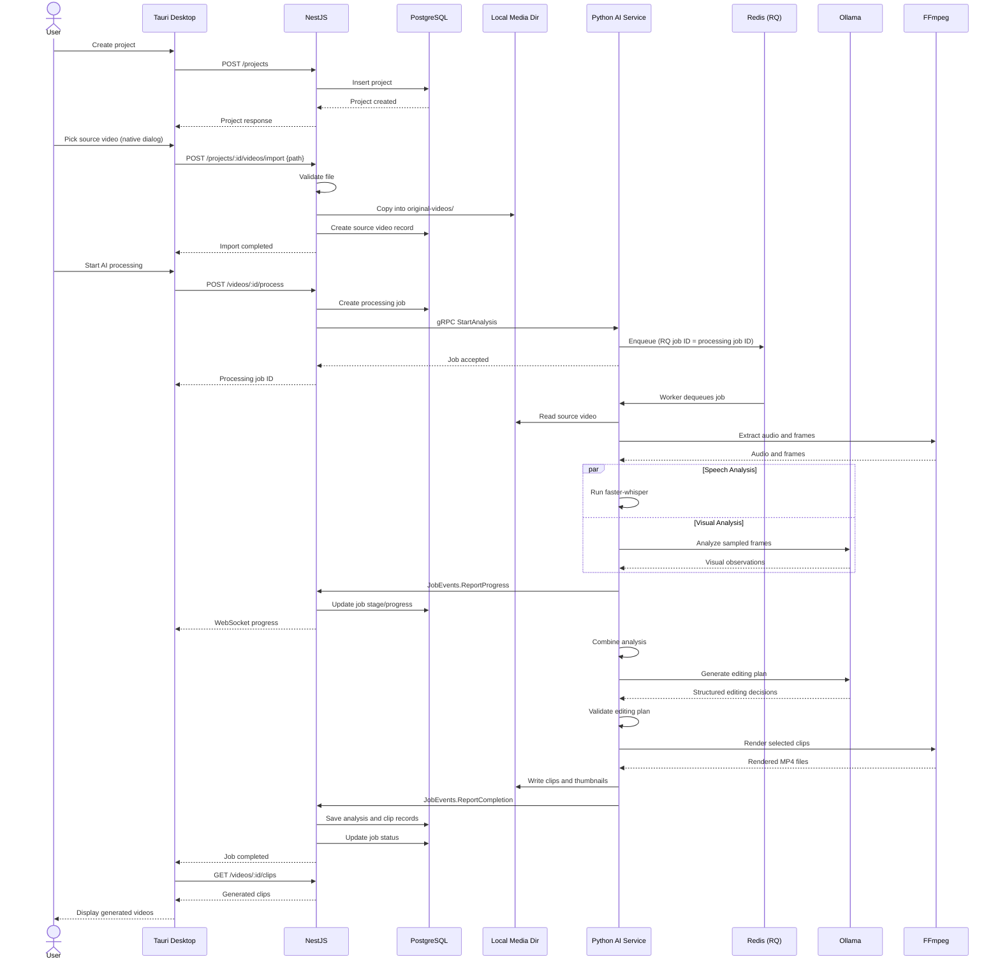
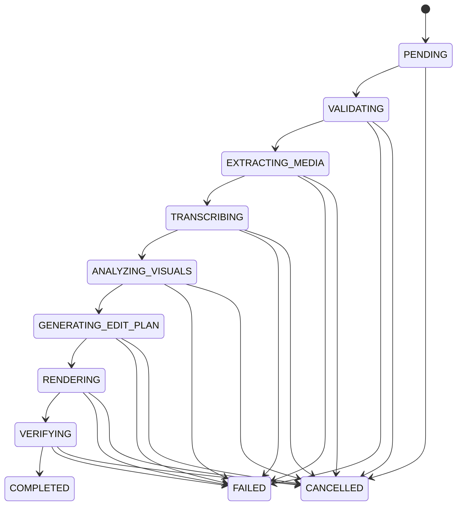
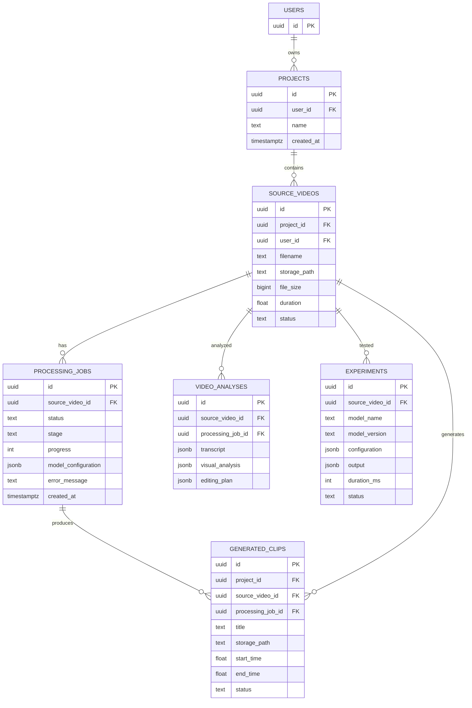
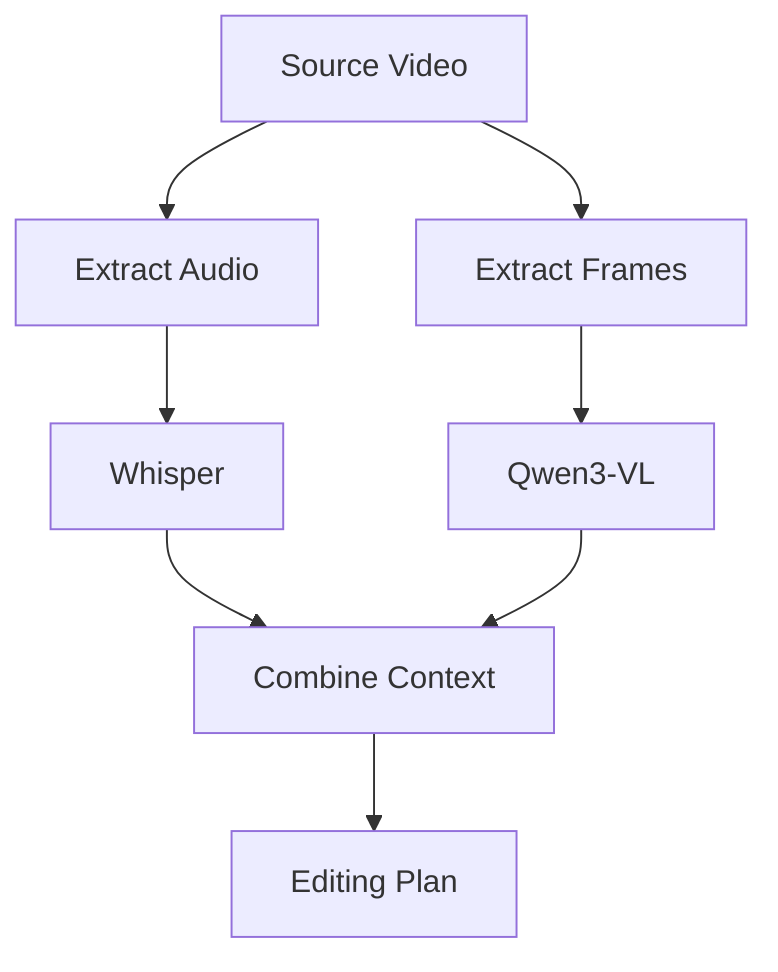

# ClipForge AI — System Design

**Document type:** System Design  
**Version:** 1.0  
**Scope:** MVP implementation  
**Architecture:** Tauri + React + NestJS + Python AI Service + PostgreSQL + Redis + Ollama (all local)

---

# 1. System Goals

ClipForge AI must provide a complete workflow for automatically creating short-form videos from user-uploaded footage.

The MVP focuses on five major capabilities:

1. Upload and manage source videos.
2. Analyze video content using local AI.
3. Generate structured editing decisions.
4. Render short-form videos automatically.
5. Preview and export the generated videos.

The application must run locally on the developer's laptop.

## 1.1 Target Hardware

Initial development hardware:

- NVIDIA RTX 4050 Max-Q.
- 16 GB system RAM.
- 512 GB SSD.
- Ubuntu Linux.

Because local inference and video rendering are resource-intensive, processing concurrency must be controlled.

The application should prioritize reliability over processing multiple videos simultaneously.

---

# 2. System Boundaries

## 2.1 Responsibilities of Each Component

### Tauri Desktop

Responsible for user interaction.

It does not perform AI reasoning or directly run video rendering commands.

### NestJS

Responsible for application business logic and job coordination.

It owns project, video, processing-job, and generated-clip records. It is the only component that writes to Postgres.

### Python AI Service

Responsible for media analysis, model inference, AI orchestration, and video rendering.

### PostgreSQL

Responsible for persistent application data. Runs locally.

### Local media directory

Responsible for storing source videos, generated clips, thumbnails, and subtitles under `MEDIA_ROOT`.

### Redis

Responsible for the Python service's durable job queue (RQ).

### Ollama

Responsible for serving local AI models.

### FFmpeg

Responsible for extracting and transforming video and audio.

---

# 3. Main System Workflow



The sequence is illustrative. For the MVP, the RQ worker runs independently after the job is enqueued. The gRPC call returns immediately after job acceptance.

---

# 4. Detailed Processing Design

## 4.1 Step 1 — Import Source Video

The user selects one or more video files with the Tauri native file dialog.

The desktop application sends each selected absolute path to NestJS (`POST /projects/:id/videos/import`).

NestJS verifies project ownership and validates the file. It then creates the source video record as `IMPORTING` and returns **202** at once. The copy into `MEDIA_ROOT/original-videos/{user}/{project}/{video}/source.{ext}` continues in the background. The user's original file is never modified or processed in place.

### Validation (before anything is written)

1. The path is absolute.
2. It is a regular file. Directories, devices and symlinks are rejected; the copy also opens the file with `O_NOFOLLOW`.
3. The extension is a known video container: mp4, m4v, mov, 3gp, 3g2, mkv, webm, avi, ts, mts, m2ts, mpg, mpeg, vob, wmv, asf, flv, ogv, mxf.
4. The size is between 1 byte and 50 GiB.
5. The file is not already inside `MEDIA_ROOT`.
6. The container signature matches the extension's family. The table is in `container-signatures.ts`; whether the codecs decode is FFprobe's job in Phase 3.
7. The media disk has room for the file plus 1 GiB.

### Copy

- Stream the copy; never load the file into memory.
- Write to `source.{ext}.part`, check the size, then rename, so an interrupted import never leaves a file that looks finished.
- Write `bytes_copied` at most once a second. The desktop polls the video list every second while any video is `IMPORTING`.
- Deleting a video aborts its copy at once. If the row disappears (the video or its project was deleted), the copy stops at its next progress tick and removes its files.
- At startup, any video still `IMPORTING` is marked `FAILED` ("Import interrupted") and its directory is removed.
- Store the relative media path, not the file binary, in PostgreSQL.

The import endpoint assumes the desktop and API share a filesystem, which holds for the local-first MVP. A remote API would need a streaming upload endpoint instead.

### Expected result

A source video record that goes `IMPORTING` → `READY`, or `FAILED` with an `error_message`.

## 4.2 Step 2 — Validate Video

Python inspects every file with FFprobe as soon as its import copy finishes (gRPC `ProbeVideo`, called by NestJS before the video becomes `READY`), and again in the `VALIDATING` stage of every processing job. The result is stored on `source_videos` (duration, width, height, frame rate, video/audio codec, has-audio, container). An undecodable file ends the import as `FAILED: "Not a playable video: …"`. If the AI service is unavailable at import time, the video still becomes `READY` without metadata. FFmpeg error messages are cleaned before they leave the AI service: file names only, never absolute paths or internal `[demuxer @ 0x…]` prefixes.

Collect:

- Duration.
- Width.
- Height.
- Frame rate.
- Video codec.
- Audio codec.
- Audio availability.
- Container format.

Reject invalid or unsupported media.

The application should clearly distinguish between a file that cannot be decoded and a file that simply has no audio.

A video without audio may still be visually analyzed, but it cannot produce speech-derived highlights or subtitles.

## 4.3 Step 3 — Extract Audio

Use FFmpeg to extract an audio stream suitable for faster-whisper.

Example:

```bash
ffmpeg -i input.mp4 \
  -vn \
  -ac 1 \
  -ar 16000 \
  output.wav
```

The exact audio settings can be adjusted based on the transcription model.

Do not retain temporary audio indefinitely. Clean up intermediate files after successful processing or according to a retention policy.

## 4.4 Step 4 — Extract Video Frames

Use FFmpeg to sample representative frames.

Initial strategy:

- Extract one frame per second for shorter test videos.
- Use lower-resolution images where possible.
- Preserve the timestamp of every extracted frame.
- Avoid loading all frames into RAM.
- Increase sampling density around potentially interesting sections.

Example:

```bash
ffmpeg -i input.mp4 \
  -vf "fps=1,scale=768:-1" \
  frames/frame-%06d.jpg
```

This is an initial experimental configuration, not a universal production setting.

For longer videos, use a configurable sampling strategy to avoid excessive image processing.

## 4.5 Step 5 — Speech Transcription

Use faster-whisper.

The transcription output should preserve timestamps.

Example:

```json
{
  "language": "en",
  "segments": [
    {
      "start": 10.2,
      "end": 13.8,
      "text": "This is one of the biggest mistakes."
    },
    {
      "start": 13.8,
      "end": 18.4,
      "text": "Most beginners make when starting."
    }
  ]
}
```

The actual schema should also support word-level timestamps when available.

Store the transcription as part of the analysis result.

## 4.6 Step 6 — Visual Analysis

Use Qwen3-VL through Ollama.

Initial experiment:

- Qwen3-VL 8B Instruct.
- Qwen3-VL 4B fallback.
- Qwen3-VL 2B as an additional lightweight candidate.

The system sends sampled frames with timestamps to the model.

The model should identify:

- Main visible subjects.
- Scene descriptions.
- Visible actions.
- Camera framing.
- Composition.
- Visual changes.
- Potentially useful visual moments.
- Whether a subject is suitable for vertical cropping.

Example output:

```json
{
  "scenes": [
    {
      "timestamp": 12.0,
      "description": "A person speaking directly toward the camera.",
      "subjects": ["person"],
      "camera_framing": "medium close-up",
      "vertical_crop_suitable": true,
      "visual_observations": [
        "The subject is centered.",
        "The background is relatively uncluttered."
      ]
    }
  ]
}
```

The model must not invent actions or claim to hear speech.

Visual observations should be grounded in the supplied frames.

## 4.7 Step 7 — Combine Audio and Visual Context

This is one of the most important parts of the application.

The system combines:

- Transcript.
- Word timestamps.
- Visual observations.
- Scene timestamps.
- Video metadata.

The AI should now understand both what is being said and what is visible.

For example:

Transcript:

"The biggest mistake is trying to do everything at once."

Visual observations:

- Person speaking directly to the camera.
- Close-up framing.
- Subject remains visible.
- No major visual obstruction.

Combined interpretation:

This moment may be suitable for a short-form educational clip because the statement is understandable, self-contained, and visually clear.

Do not rely on a single model score to determine whether a clip is engaging. The system should consider content completeness, context, visual suitability, and audio quality.

## 4.8 Step 8 — Identify Highlights

The AI identifies potential moments.

Evaluate:

- Strong opening statements.
- Complete explanations.
- Interesting opinions.
- Educational insights.
- Stories.
- Funny or surprising moments.
- Questions and answers.
- Clear conclusions.

The AI should avoid selecting fragments that lose their meaning when separated from the original video.

The system should generate a manageable number of candidate clips based on the source duration and available content.

## 4.9 Step 9 — Generate Editing Decisions

For every selected highlight, generate an editing plan.

Example:

```json
{
  "clips": [
    {
      "start_time": 42.5,
      "end_time": 68.2,
      "title": "The Biggest Beginner Mistake",
      "hook": "Most beginners get this completely wrong.",
      "caption": "A useful lesson for anyone starting out.",
      "editing": {
        "aspect_ratio": "9:16",
        "remove_silence": true,
        "subtitles_enabled": true,
        "crop_mode": "center",
        "audio_normalization": true
      }
    }
  ]
}
```

The final schema should be versioned and validated with Pydantic.

AI output is a proposal, not executable instructions.

## 4.10 Step 10 — Validate Editing Plan

Before rendering, validate:

- Clip start is non-negative.
- Clip end is greater than clip start.
- Clip boundaries are within source duration.
- Clip duration is within configured limits.
- Crop settings are valid.
- Subtitle timestamps are valid.
- Rendering options are supported.
- Required output fields exist.

If validation fails, the system may ask the model to regenerate the plan once or twice within a bounded retry policy.

Do not allow unlimited regeneration loops.

## 4.11 Step 11 — Render with FFmpeg

The renderer receives a validated editing plan.

For each clip:

1. Seek to the selected source timestamp.
2. Extract the selected segment.
3. Apply vertical 9:16 framing.
4. Apply crop and scaling.
5. Add subtitles.
6. Normalize audio if enabled.
7. Encode the result as MP4.
8. Generate a thumbnail.

Use FFmpeg through a controlled Python wrapper.

Do not construct unrestricted shell commands from model output.

The renderer should capture stderr and return meaningful error information.

## 4.12 Step 12 — Verify Output

After rendering, verify the output using FFprobe.

Check:

- Output exists.
- File size is greater than zero.
- Video stream exists.
- Audio stream exists when expected.
- Duration is valid.
- Dimensions match the selected output profile.
- Container can be decoded.

Only verified outputs should be marked as completed.

## 4.13 Step 13 — Save and Display Results

Write generated files and thumbnails to the media directory.

Report completion to NestJS through `JobEventsService.ReportCompletion`, carrying the analysis result and clip metadata.

NestJS creates generated clip records, updates the processing job, and notifies the desktop application.

The user can now preview and download the generated videos.

---

# 5. Processing Job Design

## 5.1 Job Creation

Endpoint:

```http
POST /api/v1/videos/:videoId/process
```

Example request:

```json
{
  "profile": "short_form_vertical",
  "vision_model": "qwen3-vl:8b-instruct",
  "transcription_model": "small",
  "analysis_settings": {
    "target_aspect_ratio": "9:16",
    "generate_subtitles": true
  }
}
```

The backend must validate the model configuration and confirm that the source video belongs to the authenticated user.

Example response:

```json
{
  "job_id": "job_123",
  "video_id": "video_123",
  "status": "PENDING"
}
```

Return HTTP 202 Accepted.

Do not keep the HTTP request open until video processing finishes.

## 5.2 Job State Machine



The actual implementation may execute transcription and visual analysis in parallel, subject to available resources.

## 5.3 Progress Reporting

Use stage-based progress in the MVP.

Example:

```json
{
  "job_id": "job_123",
  "status": "ANALYZING_VISUALS",
  "stage": "Visual Analysis",
  "progress": 45,
  "message": "Analyzing sampled frames..."
}
```

Progress values should represent estimated stage completion rather than pretending to know the exact remaining inference time.

Phase 3 bands:
- `VALIDATING` is 0–5.
- `EXTRACTING_MEDIA` runs 5–30 for audio and 30–99 for frames, computed from FFmpeg's `-progress` output against the probed duration and sent only when the integer percentage changes, at most every 0.5 s.
- `COMPLETED` is 100.

The `processing_jobs.status` CHECK covers only `PENDING`, `VALIDATING`, `EXTRACTING_MEDIA`, `COMPLETED`, `FAILED` and `CANCELLED`. Later phases widen it with their own migration.

---

# 6. API Design

Base path:

`/api/v1`

## 6.1 Projects

| Method | Endpoint | Description |
|---|---|---|
| POST | `/projects` | Create project |
| GET | `/projects` | List projects |
| GET | `/projects/:id` | Get project |
| PATCH | `/projects/:id` | Update project |
| DELETE | `/projects/:id` | Delete project |

## 6.2 Videos

| Method | Endpoint | Description |
|---|---|---|
| POST | `/projects/:id/videos/import` | Import a local video file into the media directory |
| GET | `/projects/:id/videos` | List source videos |
| GET | `/videos/:id` | Get source video |
| GET | `/videos/:id/file` | Stream source video (HTTP Range) |
| DELETE | `/videos/:id` | Delete source video |

## 6.3 Processing

| Method | Endpoint | Description |
|---|---|---|
| POST | `/videos/:id/process` | Start processing |
| GET | `/jobs/:id` | Get job status |
| POST | `/jobs/:id/cancel` | Cancel job |
| GET | `/videos/:id/jobs` | List video jobs (newest first) |
| GET | `/jobs/:id/frames` | Frame index of a completed job: `[{index, timestampSeconds}]` |
| GET | `/jobs/:id/frames/:index` | One frame, `image/jpeg` |
| WS | `/ws` | Server → desktop `job.updated` events (Origin-checked) |

## 6.4 Generated Clips

| Method | Endpoint | Description |
|---|---|---|
| GET | `/videos/:id/clips` | List generated clips |
| GET | `/clips/:id` | Get clip details |
| GET | `/clips/:id/file` | Stream clip file (HTTP Range) for preview and download |
| DELETE | `/clips/:id` | Delete generated clip |

## 6.5 Experiments

| Method | Endpoint | Description |
|---|---|---|
| GET | `/experiments/models` | List configured/available models |
| POST | `/experiments` | Create experiment |
| GET | `/experiments/:id` | Get experiment |
| GET | `/videos/:id/experiments` | List experiments |

The experiment API must use the same model execution and frame extraction components as the production workflow.

---

# 7. gRPC Service Design

Package:

`ai.v1`

Initial service:

```protobuf
syntax = "proto3";

package ai.v1;

service VideoAnalysisService {
  rpc StartAnalysis(StartAnalysisRequest)
      returns (StartAnalysisResponse);

  rpc CancelAnalysis(CancelAnalysisRequest)
      returns (CancelAnalysisResponse);

  rpc GetAnalysisStatus(GetAnalysisStatusRequest)
      returns (GetAnalysisStatusResponse);

  rpc RunVisualExperiment(RunVisualExperimentRequest)
      returns (RunVisualExperimentResponse);

  rpc GetModelStatus(GetModelStatusRequest)
      returns (GetModelStatusResponse);
}
```

NestJS hosts the callback service the Python worker uses to report job events:

```protobuf
service JobEventsService {
  rpc ReportProgress(ReportProgressRequest)
      returns (ReportProgressResponse);

  rpc ReportCompletion(ReportCompletionRequest)
      returns (ReportCompletionResponse);

  rpc ReportFailure(ReportFailureRequest)
      returns (ReportFailureResponse);
}
```

Every event carries the processing job ID and a monotonically increasing sequence number, so NestJS ignores duplicates and out-of-order delivery. `ReportCompletion` carries the transcript, visual analysis, editing plan, and clip metadata; NestJS writes `video_analyses` and `generated_clips` in one transaction.

If NestJS is unreachable, the worker retries with backoff. An RQ job is finished only after NestJS acknowledges its completion or failure event.

The full message definitions live in `proto/ai/v1/video_analysis.proto` (`GetModelStatus`, `ProbeVideo`, `StartAnalysis`, `CancelAnalysis`, `GetAnalysisStatus`) and `proto/ai/v1/job_events.proto` (`ReportProgress`, `ReportCompletion`, `ReportFailure`, each returning `ReportAck {applied, stop}`). Media paths in every message are relative to `MEDIA_ROOT`, and the AI service rejects any path that escapes it.

Important rules:

- Use stable identifiers.
- Use explicit timestamps and configuration fields.
- Keep request and response payloads small.
- Do not transfer video binaries.
- Return accepted/rejected status quickly.
- Use versioned contracts.
- Define error codes rather than returning arbitrary exception strings.

---

# 8. Database Design

## 8.1 Relationships



Use UUID primary keys.

Add appropriate indexes for:

- `projects.user_id`
- `source_videos.project_id`
- `processing_jobs.source_video_id`
- `processing_jobs.status`
- `generated_clips.source_video_id`
- `generated_clips.processing_job_id`

Use Row Level Security where appropriate.

Do not trust a user-supplied project or video ID without checking ownership.

## 8.2 Migration Strategy

Use version-controlled database migrations.

Recommended implementation order:

1. projects
2. source_videos
3. processing_jobs
4. video_analyses
5. generated_clips
6. experiments

Do not make schema changes manually in production without adding a migration.

---

# 9. AI Workflow State Design

LangGraph should maintain a typed workflow state.

Example conceptual structure:

```python
class VideoAnalysisState(TypedDict):
    job_id: str
    project_id: str
    video_id: str

    source_path: str
    video_metadata: dict

    audio_path: str | None
    frames: list[dict]

    transcript: dict | None
    visual_analysis: dict | None

    candidate_highlights: list[dict]
    editing_plan: dict | None

    rendered_clips: list[dict]

    current_stage: str
    errors: list[dict]
```

Keep large video and audio binaries outside the graph state.

Store temporary file references and structured results instead.

## 9.1 Parallel Processing

The audio and visual paths are logically independent.



However, parallel model inference can exceed available memory.

Use a resource manager or semaphore.

For the initial laptop configuration, process these workloads sequentially if simultaneous inference causes GPU or RAM pressure.

---

# 10. AI Model Experiment Design

The first in-app experiment should answer a practical question:

**Which local model gives the best visual understanding and editing-related output on the target hardware?**

## 10.1 Candidates

| Model | Role |
|---|---|
| Qwen3-VL 8B Instruct | Quality candidate |
| Qwen3-VL 4B | Balanced candidate |
| Qwen3-VL 2B | Lightweight candidate |

All candidates must be tested with identical inputs.

## 10.2 Experiment Inputs

- Same source video.
- Same sampled frames.
- Same timestamps.
- Same prompt.
- Same image resolution.
- Same inference settings where supported.

## 10.3 Metrics

Record:

- Model name and version.
- Quantization/runtime configuration.
- Model load time.
- Inference duration.
- Peak VRAM.
- Peak system RAM where measurable.
- Output validity.
- Scene description quality.
- Visual observation accuracy.
- Highlight usefulness.
- Timestamp alignment.
- Crop recommendation usefulness.

## 10.4 Experiment Output

Store the raw response and normalized output.

Do not discard malformed model responses. Store their validation errors too, so model reliability can be evaluated.

The experiment screen should display:

1. Source video.
2. Selected model.
3. Analysis progress.
4. Model response.
5. Parsed visual observations.
6. Validation result.
7. Execution duration.
8. Hardware metrics when available.

The experiment feature is a development and evaluation tool. It should not block the main product workflow.

---

# 11. Rendering Design

The renderer receives a validated editing plan.

Use a dedicated rendering service module.

Conceptual interface:

```python
class VideoRenderer:
    async def render_clip(
        self,
        source_path: str,
        output_path: str,
        editing_plan: dict
    ) -> dict:
        ...
```

Responsibilities:

- Resolve clip timestamps.
- Build approved FFmpeg arguments.
- Execute rendering.
- Capture logs.
- Check cancellation.
- Verify outputs.
- Return generated asset metadata.

## 11.1 Output Profile

Initial output profile:

| Property | MVP setting |
|---|---|
| Container | MP4 |
| Video codec | H.264 |
| Audio codec | AAC |
| Aspect ratio | 9:16 |
| Resolution | 1080 × 1920 target |
| Subtitle format | Burned-in subtitles |
| Frame rate | Preserve or normalize according to source/profile |

The actual rendering resolution should be configurable because hardware performance and source quality vary.

## 11.2 Temporary Files

Phase 3 keeps a job's artifacts instead of using a temporary directory, because Phase 4 analyses them and the app shows them:

```text
MEDIA_ROOT/analysis/{user}/{project}/{video}/{job}/
    audio.wav            16 kHz mono PCM (absent when the video has no audio track)
    frames/frame-000001.jpg …  one per FRAME_SAMPLE_INTERVAL s, at most FRAME_MAX_WIDTH px wide
    frames/frames.json   [{index, file, timestampSeconds}]
```

A failed or cancelled job's directory is removed by the worker. Deleting a video or project removes its `analysis/` subtree with its originals. The original temporary-directory sketch, kept for later stages that need scratch space:

```text
/tmp/clipforge/
    {job_id}/
        source/
        audio/
        frames/
        analysis/
        subtitles/
        rendered/
```

Clean up temporary files after successful processing.

On failure, preserve diagnostic logs and enough metadata to reproduce the problem. Temporary media should be removed according to a configured retention policy.

---

# 12. Real-Time Desktop Updates

The desktop needs to display job progress.

Use WebSocket notifications from NestJS: `ws://localhost:<API_PORT>/ws` (`@nestjs/websockets` with the `ws` adapter; the desktop uses the browser `WebSocket`). The upgrade is refused unless the `Origin` is one of the desktop origins. Messages: `{"event":"job.updated","data":<job>}`. The desktop reconnects with exponential backoff (1 s → 30 s). Job lists are not polled; imports still use Phase 2 polling.

Example event:

```json
{
  "event": "processing.progress",
  "data": {
    "job_id": "job_123",
    "video_id": "video_123",
    "status": "RENDERING",
    "stage": "Rendering clips",
    "progress": 75
  }
}
```

Use TanStack Query for initial and refreshed state.

WebSocket messages are notifications, not the source of truth. The database remains authoritative.

If the desktop disconnects, it should reconnect and retrieve the latest job status through REST.

---

# 13. Failure and Recovery Design

## 13.1 Retryable Failures

Examples:

- Temporary storage download failure.
- Temporary Ollama connection failure.
- Temporary FFmpeg process failure.
- Transient network interruption.

Use bounded retries with backoff.

## 13.2 Non-Retryable Failures

Examples:

- Invalid source file.
- Unsupported media.
- Corrupt source video.
- Invalid processing configuration.
- Source video deleted.
- User no longer owns the resource.

Return a meaningful error code.

## 13.3 Service Restart

Job execution is made durable with Redis + RQ:

- Redis runs with append-only persistence (`appendonly yes`), so queued jobs survive restarts.
- `StartAnalysis` enqueues with RQ `job_id = processing_job_id`; a duplicate request for an existing job is a no-op.
- Every RQ job has an explicit timeout sized to the longest expected processing run.

When the Python service starts:

1. Check Redis and model runtime connectivity.
2. Inspect RQ's started-job registry for jobs whose worker died mid-run.
3. Requeue them if under the retry limit (a job restarts from the beginning); otherwise report them to NestJS as failed.
4. Remove temporary directories of jobs that are no longer queued or running.

Rendering is idempotent: clip IDs and output paths are deterministic (e.g. UUIDv5 of processing job ID + clip index in the validated plan), so a re-run overwrites its own outputs instead of creating duplicates.

As implemented in Phase 3:
- **No automatic requeue.** A job interrupted by a worker crash is reported `FAILED / INTERRUPTED` when the worker starts (RQ's started registry, executions removed), and its artifacts are deleted. The user can process again.
- **API reconciler.** Every 30 s, NestJS checks jobs that have not changed for 30 s with `GetAnalysisStatus`. `UNKNOWN`, or `FINISHED` without a final event, becomes `FAILED / INTERRUPTED`. `QUEUED` or `RUNNING` is left alone. If the AI service is unreachable, nothing changes.
- **Events.** Each worker event carries a per-job sequence number from Redis `INCR`. NestJS applies an event only if its sequence is newer and the job is not finished, in one guarded `UPDATE`. Its acknowledgement says `stop: true` when the job is gone or finished, so deleting a video or project, or cancelling while the AI service is unreachable, still stops the worker.

---

# 14. Resource Management

The target laptop has limited memory relative to the models being tested.

The application must not assume that multiple models can be loaded simultaneously.

## 14.1 Initial Strategy

- Run one main vision model at a time.
- Limit frame batch size.
- Resize frames before inference.
- Avoid excessive context length.
- Avoid retaining all extracted images in memory.
- Use temporary disk storage.
- Limit concurrent FFmpeg renders.
- Unload models when appropriate.
- Measure peak GPU and system memory.

## 14.2 Model Configuration

Keep model settings configurable:

```text
VISION_MODEL=qwen3-vl:8b-instruct
TRANSCRIPTION_MODEL=small
OLLAMA_BASE_URL=http://localhost:11434
REDIS_URL=redis://localhost:6379/0
MEDIA_ROOT=~/.local/share/clipforge/media
JOB_EVENTS_GRPC_URL=localhost:50052
MAX_CONCURRENT_ANALYSIS=1
MAX_CONCURRENT_RENDER=1
FRAME_SAMPLE_INTERVAL=1
FRAME_MAX_WIDTH=768
```

These are initial development defaults, not fixed production values.

Do not hardcode model names throughout the application.

---

# 15. Security Design

### Authentication

Single implicit local user (no login), decided in Phase 2.
- `@CurrentUser()` resolves the user id for every request.
- Every repository method filters by that id, so another user's id gives 404, not 403.
- The API listens on localhost only.

Real accounts would replace only the `@CurrentUser()` decorator.

### Authorization

Every operation must validate resource ownership.

A user must not be able to access another user's:

- Projects.
- Source videos.
- Processing jobs.
- Generated clips.
- Experiments.

### Storage

Keep media inside `MEDIA_ROOT` with user-only file permissions. Resolve every stored path against `MEDIA_ROOT` and reject paths that escape it. The desktop reaches media only through authorized NestJS endpoints.

### Redis

Bind Redis to localhost. It holds job payloads only, never media or credentials.

### Local model access

Only trusted local application services should access Ollama.

Do not expose the model runtime as a public API.

### File processing

- Validate media formats.
- Set file size limits.
- Use isolated temporary directories.
- Avoid arbitrary filesystem paths.
- Avoid arbitrary shell commands.
- Restrict FFmpeg arguments to validated options.

---

# 16. Testing Strategy

Testing should be implemented throughout development.

## 16.1 Frontend

Test:

- Project creation.
- Video upload.
- Upload errors.
- Processing status.
- Generated clip listing.
- Video preview.
- Download behavior.

Use Playwright for end-to-end desktop application workflows where supported.

## 16.2 NestJS

Test:

- Authentication.
- Authorization.
- Project CRUD.
- Video CRUD.
- Processing job creation.
- gRPC client integration.
- JobEventsService handling (duplicate and out-of-order events).
- Video import validation.
- Clip retrieval.
- Error handling.

## 16.3 Python

Test:

- FFprobe metadata extraction.
- Audio extraction.
- Frame extraction.
- Whisper output parsing.
- Vision model response parsing.
- Editing plan validation.
- FFmpeg rendering.
- Output verification.
- Job recovery (worker killed mid-job, duplicate `StartAnalysis`).

Use fixtures and small sample videos for repeatable tests.

## 16.4 End-to-End

A complete acceptance test:

1. Open the desktop application.
2. Sign in.
3. Create a project.
4. Import a test video.
5. Start processing.
6. Confirm transcription runs.
7. Confirm visual analysis runs.
8. Confirm editing plan is generated.
9. Confirm rendering completes.
10. Confirm generated clips are displayed.
11. Preview a generated clip.
12. Download the result.
13. Confirm the exported video is playable and has the expected dimensions.

---

# 17. MVP Implementation Phases

Implement in this order. Do not begin later phases until the previous phase works.

## Phase 1 — Application Foundation

Goal: Get the application running.

Tasks:

- Create monorepo structure.
- Initialize Tauri 2.
- Set up React and TypeScript.
- Configure TanStack Router.
- Configure TanStack Query.
- Configure Tailwind and shadcn/ui.
- Initialize NestJS.
- Initialize Python FastAPI.
- Configure environment variables.
- Configure local PostgreSQL (`clipforge` database).
- Set up Redis (localhost, AOF enabled) and `MEDIA_ROOT`.
- Create health endpoints.
- Verify local communication.

The Phase 1 gRPC surface is `VideoAnalysisService.GetModelStatus` only; the remaining RPCs arrive with the phases that use them. Database access uses a plain `pg` pool. Phase 2 adds Drizzle on top of it.

Acceptance criteria:

- Desktop application starts.
- NestJS starts.
- Python service starts.
- PostgreSQL connection works.
- Desktop can call NestJS.
- NestJS can communicate with Python.

## Phase 2 — Project and Video Management

Goal: Import and manage source videos.

Spec: `spec/SPEC-phase-2.md`. Plan: `tasks/phase-2-plan.md`.

Tasks:

- Single local user and the `@CurrentUser()` seam (no login).
- Drizzle schema and migrations (users, projects, source_videos), applied at API startup.
- Implement project CRUD.
- Implement file metadata (name, size, MIME type). Media metadata comes from FFprobe in Phase 3.
- Implement validated background import into `MEDIA_ROOT`, with polled progress (§4.1).
- Implement video listing.
- Implement video deletion, including cancelling an import in progress.

Acceptance criteria:

- User can create a project.
- User can import a video.
- Imported video is stored in the media directory.
- Video metadata is persisted.
- User can see imported videos after restarting the application.

## Phase 3 — Media Processing Foundation

Goal: Process source videos without AI.

Spec: `spec/SPEC-phase-3.md`. Tasks: `tasks/phase-3-todo.md`. Status: done.

Tasks:

- Integrate FFprobe.
- Validate media.
- Extract audio.
- Extract frames.
- Create temporary job directories.
- Implement the RQ job queue and processing states.
- Implement `JobEventsService` reporting to NestJS.
- Implement cancellation and cleanup.

Acceptance criteria:

- Source videos can be inspected.
- Audio can be extracted.
- Frames can be extracted.
- Errors are handled properly.

## Phase 4 — Local AI Integration

Goal: Get meaningful AI outputs.

Tasks:

- Integrate Ollama.
- Integrate Qwen3-VL 8B.
- Integrate model availability checks.
- Implement visual analysis.
- Integrate faster-whisper.
- Implement transcription.
- Define structured response schemas.
- Persist experiment results.

Acceptance criteria:

- The application can analyze sampled frames.
- The application can transcribe speech.
- Results include timestamps.
- Model errors are displayed.
- Experiments can be inspected inside the desktop app.

## Phase 5 — AI Editing Planner

Goal: Generate valid editing decisions.

Tasks:

- Implement LangGraph workflow.
- Combine transcript and visual observations.
- Identify candidate highlights.
- Generate clip boundaries.
- Generate titles and captions.
- Generate subtitle data.
- Validate editing plans with Pydantic.
- Add bounded retry handling.

Acceptance criteria:

- AI produces a structured editing plan.
- Clip timestamps fall within the source video.
- Selected moments preserve enough context.
- Invalid model output is rejected safely.

## Phase 6 — Automatic Rendering

Goal: Turn editing plans into actual short-form videos.

Tasks:

- Implement FFmpeg renderer.
- Implement segment trimming.
- Implement vertical cropping.
- Implement subtitle rendering.
- Implement audio normalization.
- Generate thumbnails.
- Verify outputs.
- Store generated assets in the media directory.

Acceptance criteria:

- Generated clips are playable.
- Video dimensions match the selected output profile.
- Subtitles appear correctly.
- Output metadata is stored.
- Rendering errors are recoverable.

## Phase 7 — Complete Desktop Experience

Goal: Make the application usable.

Tasks:

- Implement processing dashboard.
- Display job progress.
- Implement generated clip gallery.
- Implement video preview.
- Implement download.
- Implement experiment screen.
- Improve loading and error states.
- Test the complete user workflow.

Acceptance criteria:

A user can upload a video, process it with local AI, receive automatically edited short-form videos, preview them, and export them without using the terminal.

---

# 18. MVP Definition of Done

The MVP is not complete merely because the AI model returns JSON.

It is complete when the entire application works.

### Application

- [ ] Tauri desktop application launches.
- [ ] Authentication works.
- [ ] Project management works.
- [ ] Video import works.
- [ ] Video metadata is persisted.
- [ ] Processing status survives application restarts.

### AI

- [ ] Ollama integration works.
- [ ] Vision model can analyze sampled frames.
- [ ] Whisper can transcribe speech.
- [ ] Transcript and visual context are combined.
- [ ] AI generates editing decisions.
- [ ] Editing plan validation works.

### Rendering

- [ ] FFmpeg trims selected segments.
- [ ] Vertical output works.
- [ ] Subtitles render correctly.
- [ ] Generated videos are verified.
- [ ] Thumbnails are generated.
- [ ] Outputs are stored successfully.

### User Experience

- [ ] Processing progress is displayed.
- [ ] Errors are understandable.
- [ ] Generated clips appear in the application.
- [ ] Users can preview clips.
- [ ] Users can download clips.

---

# 19. Post-MVP Roadmap

Only after the MVP is usable should we expand the system.

### AI improvements

- Compare 2B, 4B, and 8B vision models.
- Improve highlight selection.
- Improve visual reframing.
- Improve subtitle styling.
- Add speaker detection.
- Add more advanced content understanding.

### Video editing improvements

- Combine multiple source videos.
- Add advanced pacing.
- Add transitions.
- Add music.
- Add B-roll.
- Add editing presets.

### Infrastructure improvements

- Introduce Kafka.
- Separate rendering workers.
- Introduce distributed processing.
- Add durable event-driven workflows.
- Improve observability.
- Add cloud processing options.

### Product improvements

- Direct social media publishing.
- Scheduling.
- Platform-specific export presets.
- Analytics.
- User preferences.
- Content performance feedback.

---

# 20. Final Engineering Priorities

The implementation order matters.

Do not start by building Kafka infrastructure, advanced AI agents, a complex editing timeline, or a distributed rendering system.

First, make this work:

```text
Upload Video
     |
     v
Extract Audio and Frames
     |
     v
Whisper + Qwen3-VL
     |
     v
AI Editing Plan
     |
     v
Validate Editing Plan
     |
     v
FFmpeg Rendering
     |
     v
Generated Short-Form Video
     |
     v
Preview and Export
```

Everything else supports this workflow.

**The first usable release should demonstrate one complete promise: upload a source video and let ClipForge AI turn it into short-form content automatically.**